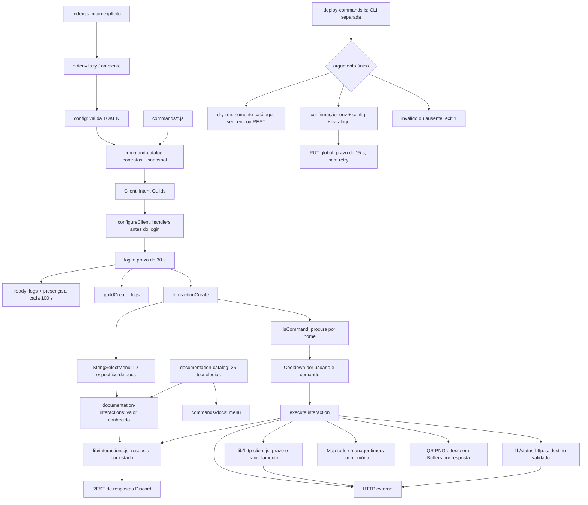

# Arquitetura implementada

Auditoria inicial de 2026-11-07, base `cea09b90889716b5b05139eaf06f8b0e858f179e`. Atualização **P2.3 — R14**, em **2026-11-08**, base `develop/67c25a3` (ADR 0003 já commitado). Node 24/Prettier de produção vêm do P0; SSRF vem da P1.1 e respostas/prazos HTTP da P1.2. P1.3 protege configuração/catálogo/login, registro e timers; P2.1 elimina arquivos QR e limita conteúdo/HTTP/memória. P2.2 isola `/todo` por contexto, torna suas respostas privadas e agrega cotas por usuário conforme [ADR 0002](decisions/0002-privacidade-e-isolamento-do-todo.md). O [ADR 0003](decisions/0003-estado-operacional-temporario.md) estabelece estado operacional exclusivamente em memória e aceita sua perda após reinício, sem mudar código ou contratos. P2.3 centraliza as 25 tecnologias de `/docs` e limita seu roteamento ao identificador específico do componente, sem mudar payloads slash. R14 `RESOLVED` no escopo offline: suíte 863/863, sintaxe 56/56 e 23 contratos/hash preservados; a comparação com a base confirma as 25 opções e mensagens, exceto a URL C++ atualizada deliberadamente. Discord/APIs reais continuam `NOT_CONFIRMED`. Consulte [estado](PROJECT_STATE.md), [comandos](COMMANDS.md), [operação](OPERATIONS.md) e [riscos](KNOWN_RISKS.md).

## Componentes e responsabilidades

É um bot JavaScript CommonJS em um único processo Node.js, orientado a eventos do discord.js 14. Cada comando concentra definição pública e execução, com módulos locais para configuração, catálogos de comandos/documentação, inicialização/registro, respostas, HTTP e timers. Não há camadas de domínio ou repositórios separadas, banco de dados, servidor HTTP próprio, fila, CI ou infraestrutura de hospedagem versionada. A suíte `node:test` usa relógio, Discord e transporte simulados; evidências e limites estão em qualidade.

| Componente | Responsabilidade efetiva |
|---|---|
| [index.js](../../index.js) | Exporta `main` e `configureClient`; registra eventos/cooldowns/menu antes do login. O guard `require.main` impede iniciar o bot ao importar o módulo. |
| [deploy-commands.js](../../deploy-commands.js) | CLI separada de registro com guard `require.main`: valida o catálogo com `--dry-run` ou exige `--confirm-global-replacement` para o PUT global. Não é chamada pelo runtime. |
| [lib/config.js](../../lib/config.js) | Validação local de TOKEN opaco e CLIENT_ID de registro; mensagens fixas sem valores sensíveis. Não consulta credenciais remotamente. |
| [lib/command-catalog.js](../../lib/command-catalog.js) | Carregamento ordenado e validação compartilhada de contratos, nomes/opções e snapshot JSON; falha bloqueia o catálogo inteiro. |
| [lib/documentation-catalog.js](../../lib/documentation-catalog.js) | Fonte única das 25 tecnologias, com identificador, label, descrição e URL; ordem pela posição no array. Valida dados/limites e expõe snapshot congelado, opções e lookup por Map. |
| [lib/documentation-interactions.js](../../lib/documentation-interactions.js) | Trata somente string select com `codebucket:docs:select`; valida exatamente uma seleção conhecida e responde pelo helper comum, sem consultar URLs. |
| [lib/startup.js](../../lib/startup.js) | Ordena ambiente/configuração, catálogo, Client, handlers e login; limita login e limpeza em falhas, com saída de erro controlada. |
| [lib/registration.js](../../lib/registration.js) | Decide modo da CLI, prepara/revalida configuração e payload e faz PUT global somente quando confirmado; REST sem retry e erros sanitizados. |
| [commands/](../../commands/) | 23 módulos com `data` (SlashCommandBuilder) e `async execute(interaction)`; definição pública e comportamento permanecem locais, delegando envio de respostas e prazos HTTP aos helpers. |
| [lib/status-http.js](../../lib/status-http.js) | Política de URLs/IPs, resolução DNS e GET de `/status` preso a um IP validado, com limites e erros sanitizados. Usa somente módulos nativos do Node. |
| [lib/interactions.js](../../lib/interactions.js) | Defer, reply/edit/followUp por estado, visibilidade, expiração, falhas sem retry e captura de operações secundárias. `runWithErrorHandling` envolve o listener. |
| [lib/http-client.js](../../lib/http-client.js) | GET axios e fetch/JSON com prazo total de 5000 ms, corpo até 1 MiB antes do parse, cancelamento e erro sanitizado; não substitui a política SSRF de `/status`. |
| [lib/timers.js](../../lib/timers.js) | Duração e chave de contexto, Map de agendamentos com relógio injetável, cancelamento/expiração por identidade e captura do envio final. |
| [lib/todo-store.js](../../lib/todo-store.js) | Maps por usuário/contexto, contexto explícito de servidor ou DM, operações síncronas e cotas agregadas por usuário/processo; sem persistência. |
| [tests/](../../tests/) | Testes offline de contratos, SSRF, interações, HTTP, configuração, bootstrap, registro, timers, arquivos/limites, privacidade/isolamento/cotas de todo e catálogo/roteamento de docs, sem credenciais ou rede reais. |
| [images/](../../images/) | Três imagens versionadas; `lofiradio.jpeg` e `lofiicon.png` são anexadas pelo comando Lofi. A presença de `topgg.png` não implica seu uso por `/vote`. |
| [package.json](../../package.json), [package-lock.json](../../package-lock.json) | Faixas de dependências e resolução exata. Lockfile v3; entrada principal `index.js`; script `test` executa `node --test`. P1.3 não adiciona dependências. |
| [.nvmrc](../../.nvmrc) | Versão exata Node `24.22.2`; `engines.node` em `package.json` declara a linha `24.x`. A ativação local está descrita em operação. |
| [.gitignore](../../.gitignore), [.env.example](../../.env.example) | `.env` e `node_modules` ignorados; exemplo público de configuração. Segredos são locais/externos ao Git. |
| [AGENTS.md](../../AGENTS.md), [docs/](../README.md) | Protocolo permanente e memória documental. Descrevem o sistema; não implementam comportamento do bot. |

## Inicialização e ciclo de vida

1. Importar os pontos de entrada não faz login nem registro. `index.main` carrega dotenv somente quando invocado; `.env` continua relativo ao diretório de execução e variáveis já injetadas prevalecem.
2. `readConfig` valida TOKEN antes do catálogo e da criação do Client. Remove prefixo convencional `Bot`/`Bearer`, aceita token opaco de 20–512 caracteres ASCII alfanuméricos ou `_ . -` e recusa placeholders/formas evidentemente inválidas. Isso não comprova validade, identidade ou associação remota da credencial.
3. `loadCommandCatalog` importa os arquivos `.js` diretamente em `commands/`, ordenados, e valida `execute`, builder, serialização, nomes únicos e opções. Recusa catálogo vazio/parcial, campos não suportados, valores inseguros e estruturas não representáveis no snapshot JSON; a política aceita os contratos slash atuais. Importar módulos continua executando JavaScript confiável do projeto, sem sandbox por comando.
4. Só após esses checks cria o Client com intent `Guilds`. `configureClient` preenche `client.commands` pelo catálogo validado e instala handlers de eventos, erros e interações **antes** de chamar login. Não há leitura de mensagens, intent privilegiado de membros ou reprodução de áudio.
5. O login tem prazo de 30 s. Rejeição/timeout ou falha de preparação produz mensagem fixa e `exitCode = 1`; a limpeza da aplicação e `client.destroy()` têm janela de 2 s. Um watchdog de 5 s com `unref()` encerra com erro se recursos remanescentes mantiverem o processo vivo. Resultado tardio do login não é usado como sucesso, nem seu retorno/token é logado.
6. `ready` mantém os logs de tag/servidores e a seleção de uma das 27 presenças a cada 100 s; o efeito da presença é protegido por `runSecondary`. `guildCreate` mantém data/hora em `pt-BR`, sem fixar fuso. Esses eventos reais não foram exercitados nesta fase.
7. O cleanup retornado por `configureClient` remove intervalo de presença, timeouts de cooldown e listeners operacionais em falha de inicialização. Mantém somente um handler fixo de erro para falhas tardias durante a destruição do SDK; esse listener não mantém o event loop ativo. Não há rotina geral de SIGINT/SIGTERM; `timers.clearAll` está disponível no manager, sem integração automática ao encerramento do processo. Estado operacional não é persistido nem restaurado: parar o bot o perde, comportamento aceito no [ADR 0003](decisions/0003-estado-operacional-temporario.md). Consulte [OPERATIONS.md](OPERATIONS.md).

## Interações, cooldown e erros

O listener examina primeiro `isStringSelectMenu()` e delega a [documentation-interactions.js](../../lib/documentation-interactions.js). O handler atende somente `customId = "codebucket:docs:select"` e exige `values` como array de exatamente uma string presente no catálogo. Seleções válidas recebem o texto/link público existente; valores desconhecidos ou malformados recebem apenas “Opção não reconhecida.”, sem ecoar entrada nem consultar URLs. O lookup por Map não aceita propriedades herdadas. Outros selects retornam sem resposta e sem cair no fluxo slash/cooldown. Menus continuam sem cooldown e podem ser usados por outros usuários, como antes.

[documentation-catalog.js](../../lib/documentation-catalog.js) concentra as 25 entradas em ordem de apresentação, com snapshot congelado e cópias de opções para o builder. Rejeita catálogo vazio ou acima de 25, IDs não canônicos/duplicados, labels/descrições vazios, Unicode inválido ou acima de 100 unidades UTF-16, URLs HTTPS inválidas/com credenciais e resposta acima do limite de mensagem. A única manutenção dos dados é nesse módulo; alterar a posição muda a ordem. Uma 26ª tecnologia exige decisão própria sobre a experiência do menu, sem paginação implícita.

Os menus antigos publicados com `customId = "select"` são ignorados. O identificador genérico não comprova a origem `/docs`; não há inferência pelo texto/valor da mensagem nem compatibilidade indiscriminada. O usuário substitui o menu executando `/docs` novamente; mensagens antigas não são editadas ou removidas. Laravel existia somente no mapa histórico, nunca nas 25 opções preservadas; não integra o catálogo nem o roteamento atual.

Para `isCommand()`, procura o nome na Collection; se não encontrar, apenas registra erro e retorna. O cooldown é uma Collection por comando contendo timestamps por ID de usuário. Usa `(command.data.cooldown || 5) * 1000`; nenhum módulo define `data.cooldown`, portanto o padrão atual é cinco segundos. A chave não inclui servidor. Registra o timestamp antes de executar, mesmo quando a execução falha, e o remove por `setTimeout`; reinícios e outros processos não compartilham esse limite. Os handles são acompanhados para limpeza em falha de inicialização.

O listener inteiro é envolvido por `runWithErrorHandling`; select, cooldown e os 23 comandos usam `respond`. Sem reconhecimento, responde com reply; defer pendente usa editReply; resposta concluída usa followUp. `/ping` usa `editResponse` para editar a mensagem original privada. Uma WeakMap registra envio em andamento, falha e erro já reportado, evitando duplicação/retry após entrega ambígua. Códigos terminais e prazo local impedem novo envio; o tratamento da própria falha de resposta também é capturado. Logs novos usam somente mensagens fixas.

Defer é público por padrão. Para manter erros efêmeros depois dele, o helper conclui o loading com U+200B neutro, envia o resultado privado em follow-up com flag 64 e remove o placeholder. A edição original nunca recebe conteúdo privado; uma falha encerra a sequência, podendo deixar o placeholder neutro. Isso respeita a visibilidade imutável do reconhecimento e evita a semântica especial do primeiro follow-up após defer, descrita no [contrato Discord](https://docs.discord.com/developers/interactions/receiving-and-responding).

Reações usam `runSecondary`, que aguarda/captura falha sem invalidar a resposta principal. O manager de timers captura o envio tardio depois de remover o agendamento, sem reutilizar a interação. P2.1 gera QR em Buffer, captura falhas de geração com aviso privado e não cria arquivo mesmo se o envio falhar. Os prazos são verificados antes de cada chamada REST (3 s sem reconhecimento, 15 min para interação reconhecida desde a criação); rede/carga, relógio local e operação remota continuam limitações explícitas.

## Registro e autenticação

[deploy-commands.js](../../deploy-commands.js) delega a [registration.js](../../lib/registration.js). A CLI aceita exatamente **um** argumento: `--dry-run` valida o catálogo sem carregar `.env`/credenciais e sem REST; `--confirm-global-replacement` carrega ambiente, valida TOKEN/CLIENT_ID e o mesmo catálogo usado pelo runtime antes do PUT. Sem argumento, com opções desconhecidas ou combinadas, retorna erro e não envia nada. A API de envio também exige confirmação explícita e revalida configuração/payload.

`CLIENT_ID` deve ser string decimal de 17–20 dígitos, sem zero inicial e dentro de uint64; só o modo de registro o exige. O snapshot do payload é validado antes de criar a instância REST. O PUT usa Discord v10, `Routes.applicationCommands(CLIENT_ID)`, prazo/sinal de cancelamento de 15 s, `retries: 0` e rejeição de rate limit. Falha retorna mensagem fixa e código 1; os recursos locais de REST são limpos sem repetir o PUT. O alvo continua global, sem `GUILD_ID`, e substitui todo o conjunto remoto; não há registro individual ou por servidor.

O registro não inicia o Client e o runtime não registra comandos remotamente. Configuração do aplicativo, scopes, permissões e correspondência de token/aplicação dependem do Discord; seu estado atual é `NOT_CONFIRMED`. O fallback de `/invite` aponta para um ID de aplicação fixo com scopes `bot applications.commands` e `permissions=0`, que não comprova permissões efetivas nos canais.

**Não executar o modo confirmado como teste local.** A proteção da CLI não concede autorização para alterar o catálogo remoto; o modo dry-run apenas valida arquivos locais. Envio, rate limit, permissões e estado remoto permanecem `NOT_CONFIRMED`.

## Dependências e integrações

| Dependência | Versão resolvida no lock | Uso observado |
|---|---|---|
| discord.js | 14.18.0 | Gateway, builders, Collections, respostas e registro REST; API REST v10. |
| axios | 1.8.4 | Consultas HTTP em cinco comandos via `lib/http-client.js`; `/status` usa `node:http` e `node:https`. |
| dotenv | 16.4.7 | Carregado de forma lazy pelo bootstrap e pelo modo confirmado de registro; dry-run não o chama. |
| qrcode | 1.5.4 | Geração de PNG local. |
| node-fetch | 3.3.2 | Declarado, mas sem importação encontrada; `/github` usa `fetch` global. |
| prettier | 3.5.3 | Formatação de código durante execução; dependência de produção, obrigatória no carregamento. A Fase 1 moveu a mesma faixa `^3.5.3` de devDependencies para dependencies. |

`/translate` importa `@discordjs/builders` diretamente, embora ele seja apenas dependência transitiva do discord.js. O projeto declara `engines.node: "24.x"` e fixa `24.22.2` em `.nvmrc`. Os requisitos antigos do lock chegam a Node `>=18.17` por `undici 6.21.1`; esse mínimo de pacote não substitui a política atual Node 24. A distribuição oficial Node `24.22.2` inclui npm `11.19.1`. Ambiente, fontes da versão e ativação estão em [OPERATIONS.md](OPERATIONS.md).

Na auditoria inicial, Prettier era devDependency, embora importado por `/formatar` durante a inicialização. A classificação foi corrigida na Fase 1 ([R02](KNOWN_RISKS.md#r02)) sem upgrade de faixa ou versão resolvida. Com Node `24.22.2` e npm `11.19.1`, instalações limpas separadas com `npm ci` e `npm ci --omit=dev`, ambas com `--engine-strict`, passaram: 85 pacotes com versões iguais ao lock, 25 fontes com sintaxe válida e 23 comandos importados/serializados com nomes únicos em cada modo. O payload JSON permaneceu idêntico ao baseline anterior à mudança; os cinco parsers de `/formatar` passaram com resposta simulada. Isso resolve o carregamento em produção de R02, sem comprovar login ou operação no Discord. Métodos, isolamento e resultados estão em [QUALITY_GATES.md](QUALITY_GATES.md).

| Fronteira externa | Comandos / uso | Autenticação observada |
|---|---|---|
| Gateway e REST Discord | Login, eventos, respostas e registro global | `TOKEN`; `CLIENT_ID` para registro. |
| `api.github.com` | `/github`: dados de repositório via fetch global; `/repositorys`: busca por linguagem via axios | Sem token explícito. |
| `api.stackexchange.com/2.3/search` | `/question`: pesquisa de títulos no Stack Overflow | Sem chave explícita. |
| `translate.googleapis.com/translate_a/single` | `/translate`: tradução com `client=gtx`, origem automática | Sem chave explícita. |
| `api.exchangerate-api.com/v4/latest` | `/moeda`: taxas e cálculo local | Sem chave explícita. |
| `httpstat.us` | `/http`: código/descrição HTTP; 1xx é tratado localmente | Sem chave explícita. |
| URL fornecida pelo usuário | `/status`: GET HTTP(S) direto do Node, após política de destino e DNS; prazo total de 5000 ms, corpo até 1 MiB, cabeçalhos até 16 KiB, zero redirecionamentos | Sem autenticação; URLs com credenciais são rejeitadas. |
| Spotify, top.gg, Lofi Radio, autor, documentação, imagens externas | Links, botões e imagens exibidos nas mensagens/presença | Não há integração OAuth/API própria nesses links. |

Os sete comandos HTTP deferem antes da API. Axios e fetch/JSON têm prazo total de 5000 ms com AbortSignal; `/status` conserva seu prazo e transporte próprios. Validações rápidas de `/question` e `/http` 1xx não deferem nem consultam API. `/formatar`, `/qrcode` e upload Lofi também reconhecem antes do trabalho demorado. Disponibilidade, rate limits, contratos atuais e destinos de links não foram verificados remotamente. As únicas variáveis de ambiente da aplicação permanecem `TOKEN`, `CLIENT_ID`, `INVITE_URL` e `LOFIRADIO_URL`.

### Fronteira HTTP de `/status` — P1.1

O helper normaliza a URL com WHATWG, mantém HTTPS como padrão para entradas sem esquema e aceita apenas HTTP(S), sem credenciais. Rejeita nomes locais e endereços privados, loopback, link-local, metadata e faixas especiais/reservadas IPv4. Para IPv6, aceita conservadoramente unicast global `2000::/3`, com exclusões especiais; também rejeita IPv4-mapped, tradução e transição. Essa política pode recusar alguns endereços especiais roteáveis e não usa uma allowlist de domínios.

Antes de conectar, `dns.lookup` obtém os endereços disponíveis com `all: true`; qualquer resultado não público invalida a consulta inteira. O transporte recebe o IP numérico aprovado como `hostname`, preservando Host e a identidade TLS do domínio original. Não há segunda resolução DNS, reutilização de conexão ou proxy do agente global (`agent: false`), e a validação de certificado permanece habilitada. `http.request`/`https.request` não seguem `Location`.

Um prazo único de 5000 ms cobre DNS, conexão, TLS, cabeçalhos e corpo; uma resolução tardia não inicia nova requisição. O corpo é contado e descartado em streaming, sem armazenar, interpretar ou descomprimir conteúdo remoto. A interface mantém embeds verde/vermelho e os códigos HTTP; exibe somente a origem da URL, sem caminho ou query. Falhas usam uma mensagem fixa, sem erro bruto, corpo, cabeçalhos ou logs. P1.2 acrescentou defer público e continuação da resposta, sem alterar esse helper SSRF ou seus testes; [R07](KNOWN_RISKS.md#r07) foi corrigido no escopo local.

As faixas devem ser revistas quando os registros especiais [IPv4](https://www.iana.org/assignments/iana-ipv4-special-registry/) e [IPv6](https://www.iana.org/assignments/iana-ipv6-special-registry/) da IANA mudarem. A semântica de agentes e proxies usada aqui está na [documentação HTTP do Node 24](https://nodejs.org/docs/latest-v24.x/api/http.html).

## Estado e acoplamentos

- `/todo` mantém Maps por usuário e contexto: servidor+usuário ou DM+usuário, independente do canal de DM. As três operações exigem contexto válido, sem fallback global; respostas e anexos são efêmeros, erros/logs não reproduzem tarefas. Cotas de 100 tarefas/64 KiB são agregadas por usuário entre contextos; 8 MiB/1024 usuários continuam globais, sem expulsão silenciosa. Decisão em [ADR 0002](decisions/0002-privacidade-e-isolamento-do-todo.md). `/timer` conserva usuário+servidor ou usuário+canal de DM, conforme [ADR 0001](decisions/0001-isolamento-dos-timers.md).
- Operações de `/todo` validam e admitem inserções ou removem estado sincronamente, antes do await do envio. A lista devolvida é cópia defensiva; remoção libera contadores/contextos/usuário vazios. Falha de confirmação mantém o efeito local. Todo estado operacional permanece exclusivamente em memória: reiniciar apaga tarefas, timers e cooldowns, sem sincronização entre processos, replay ou recuperação de estado após falha de hospedagem. Essa perda é conhecida e aceita no [ADR 0003](decisions/0003-estado-operacional-temporario.md); R09 continua `MITIGATED`, com volatilidade deliberada e proteções de privacidade/isolamento preservadas. Persistência não é pendência técnica: bancos, arquivos de estado e dependências/infraestrutura para esse fim não devem ser introduzidos sob a política vigente. Não há migração automática da antiga lista global para contextos inferidos.
- `/timer` aceita 1–1440 minutos inteiros sem coerção. O scheduler e relógio são injetáveis; cada entry tem identidade própria. Substituição válida agenda antes de cancelar o anterior; cancelamento/expiração removem o estado e callbacks obsoletos não afetam o novo timer. O aviso não é reenviado e um envio já iniciado não é cancelado retroativamente. Falha da confirmação mantém o efeito local.
- `/qrcode` gera PNG em Buffer por execução; anexos de texto extensos também são Buffers, sem escrita/cwd/cleanup. [content-limits.js](../../lib/content-limits.js) valida limites individuais/agregados e preserva conteúdo completo em anexo; [todo-store.js](../../lib/todo-store.js) limita texto/cardinalidade das listas. Políticas em [COMMANDS](COMMANDS.md).
- Runtime e registro importam todos os módulos pelo mesmo catálogo: uma dependência ausente bloqueia a preparação inteira com erro sanitizado, antes de login/PUT. A validação não isola efeitos arbitrários no topo de módulos JavaScript.
- `/docs` e seu handler consomem o mesmo catálogo de documentação; `index.js` apenas delega o select específico. `/help` deriva dinamicamente nomes e descrições da Collection de comandos carregados, sem consultar o registro remoto.
- IDs, cores, rodapés, links e mensagens estão repetidos nos comandos. Não há configuração central desses dados.

Oportunidades **propostas, sem implementação adicional nesta tarefa**: ampliar governança de contratos/quota externos e avaliar encerramento geral conforme necessidade. O estado temporário é uma decisão estabelecida, não uma pendência de retenção/persistência; mudá-la exigiria nova decisão explícita que substitua o ADR 0003. Fontes, assets, configuração/credenciais e mensagens já entregues ao Discord não são um mecanismo de persistência do estado operacional do bot. A sequência sugerida está em [ROADMAP.md](ROADMAP.md); não representa aprovação automática. R04/R08/R13 e demais correções são avaliados no escopo local das evidências de [QUALITY_GATES](QUALITY_GATES.md), sem certificar operação remota.
