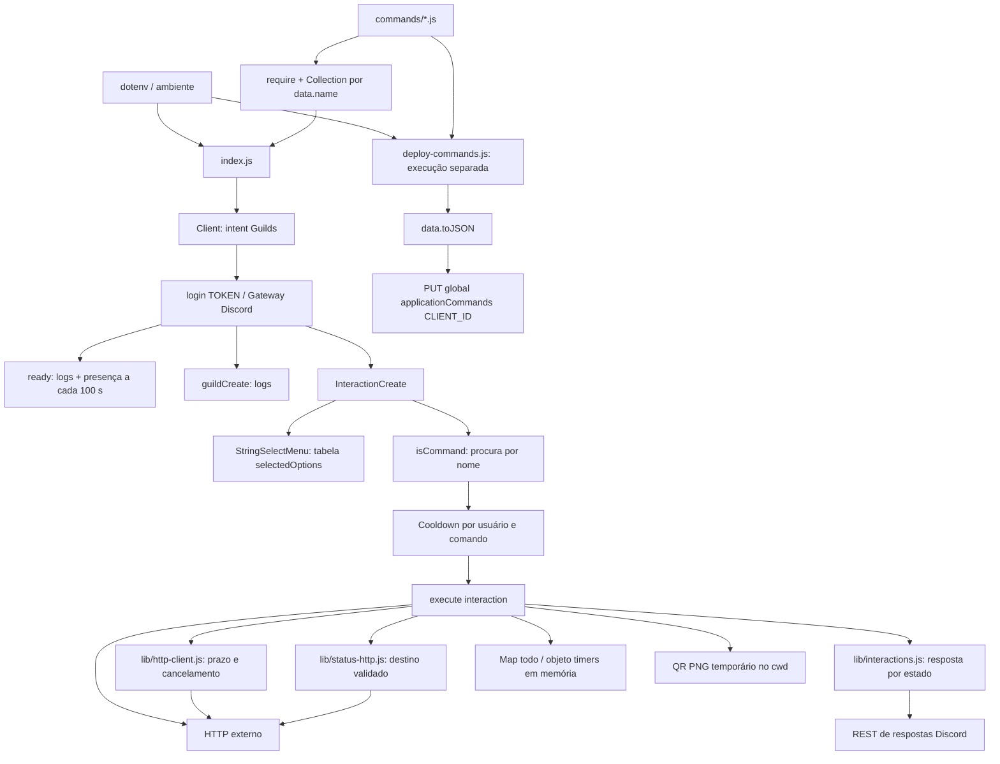

# Arquitetura implementada

Auditoria inicial de 2026-11-07, base `cea09b90889716b5b05139eaf06f8b0e858f179e`. Atualização P1.2 na mesma data, a partir de `develop` / `234f01b` (`P1.1` já commitada). Node 24 e Prettier de produção vêm do P0; a proteção SSRF e a suíte permanente vêm da P1.1. P1.2 compartilha respostas por estado e prazos HTTP, preservando os contratos públicos. As alterações P1.2 estão sem commit. Conexão com Discord e APIs externas permanece `NOT_CONFIRMED`. Consulte também [estado](PROJECT_STATE.md), [comandos](COMMANDS.md), [operação](OPERATIONS.md) e [riscos](KNOWN_RISKS.md).

## Componentes e responsabilidades

É um bot JavaScript CommonJS em um único processo Node.js, orientado a eventos do discord.js 14. Cada comando concentra definição pública e execução, com helpers locais para resposta, prazo HTTP e proteção de `/status`. Não há camadas de domínio ou repositórios separadas, banco de dados, servidor HTTP próprio, fila, CI ou infraestrutura de hospedagem versionada. A suíte `node:test` cobre SSRF, contratos, interações e falhas HTTP/secundárias; as evidências estão em qualidade.

| Componente | Responsabilidade efetiva |
|---|---|
| [index.js](../../index.js) | Carrega configuração e módulos, instancia Client, conecta ao Gateway, trata eventos, cooldowns e select menu de documentação. |
| [deploy-commands.js](../../deploy-commands.js) | Processo separado que importa os mesmos comandos e substitui sua definição global na API REST Discord v10. Não é chamado pelo runtime. |
| [commands/](../../commands/) | 23 módulos com `data` (SlashCommandBuilder) e `async execute(interaction)`; definição pública e comportamento permanecem locais, delegando envio de respostas e prazos HTTP aos helpers. |
| [lib/status-http.js](../../lib/status-http.js) | Política de URLs/IPs, resolução DNS e GET de `/status` preso a um IP validado, com limites e erros sanitizados. Usa somente módulos nativos do Node. |
| [lib/interactions.js](../../lib/interactions.js) | Defer, reply/edit/followUp por estado, visibilidade, expiração, falhas sem retry e captura de operações secundárias. `runWithErrorHandling` envolve o listener. |
| [lib/http-client.js](../../lib/http-client.js) | GET axios e fetch/JSON com prazo total de 5000 ms, cancelamento e erro sanitizado; não substitui a política SSRF de `/status`. |
| [tests/](../../tests/) | Seis arquivos `node:test` com DNS, transporte e interações simulados; contratos, SSRF, estado/visibilidade de respostas, prazos HTTP e operações secundárias. |
| [images/](../../images/) | Três imagens versionadas; `lofiradio.jpeg` e `lofiicon.png` são anexadas pelo comando Lofi. A presença de `topgg.png` não implica seu uso por `/vote`. |
| [package.json](../../package.json), [package-lock.json](../../package-lock.json) | Faixas de dependências e resolução exata. Lockfile v3; entrada principal `index.js`; script `test` executa `node --test`. P1.1 não adiciona dependências. |
| [.nvmrc](../../.nvmrc) | Versão exata Node `24.22.2`; `engines.node` em `package.json` declara a linha `24.x`. A ativação local está descrita em operação. |
| [.gitignore](../../.gitignore), [.env.example](../../.env.example) | `.env` e `node_modules` ignorados; exemplo público de configuração. Segredos são locais/externos ao Git. |
| [AGENTS.md](../../AGENTS.md), [docs/](../README.md) | Protocolo permanente e memória documental. Descrevem o sistema; não implementam comportamento do bot. |

## Inicialização e ciclo de vida

1. `dotenv.config()` carrega `.env` relativo ao diretório de execução; o runtime lê `TOKEN` ([index.js:5–7](../../index.js#L5)).
2. `fs.readdirSync` encontra somente arquivos `.js` diretamente em `commands/`, usando caminho a partir de `__dirname`. Cada módulo é importado antes do login. A verificação exige apenas as propriedades `data` e `execute`; a Collection usa `command.data.name` como chave ([index.js:12–26](../../index.js#L12)).
3. O Client solicita somente o intent `Guilds` ([index.js:15](../../index.js#L15)). Não há leitura de mensagens, intent privilegiado de membros ou reprodução de áudio implementados.
4. `ready` imprime tag do bot e nomes/IDs/contagens dos servidores em cache. Um intervalo de 100 segundos seleciona uma das 27 presenças estáticas. Os textos de presença, como “monitorando métricas”, não comprovam funcionalidades correspondentes ([index.js:28–161](../../index.js#L28)).
5. `guildCreate` registra entrada em servidor, data/hora local do processo e total em cache. A região `pt-BR` formata o texto, sem fixar fuso horário ([index.js:164–174](../../index.js#L164)).
6. `client.login(TOKEN)` inicia a conexão, sem validação de ambiente ou tratamento explícito de rejeição dessa Promise. A tabela de documentação e o listener de interações são declarados na sequência; `/docs` é novamente registrado na mesma Collection ([index.js:175–211](../../index.js#L175)).
7. Não há handlers próprios de SIGINT/SIGTERM, `client.destroy()` de encerramento, limpeza do intervalo de presença, persistência ou recuperação automática do estado de comandos. Parar o processo perde estado volátil; operação está descrita em [OPERATIONS.md](OPERATIONS.md).

## Interações, cooldown e erros

O listener examina primeiro `isStringSelectMenu()`. Pega `values[0]`, consulta `selectedOptions` e responde com o link ou “Opção não reconhecida”. A tabela contém 26 tecnologias, e o menu de `/docs` é construído separadamente em [commands/docs.js](../../commands/docs.js). Não há validação do `customId` nem cooldown para select menus ([index.js:178–229](../../index.js#L178)).

Para `isCommand()`, procura o nome na Collection; se não encontrar, apenas registra erro e retorna. O cooldown é uma Collection por comando contendo timestamps por ID de usuário. Usa `(command.data.cooldown || 5) * 1000`; nenhum módulo define `data.cooldown`, portanto o padrão atual é cinco segundos. A chave não inclui servidor. Registra o timestamp antes de executar, mesmo quando a execução falha, e o remove por `setTimeout`; reinícios e outros processos não compartilham esse limite ([index.js:230–267](../../index.js#L230)).

O listener inteiro é envolvido por `runWithErrorHandling`; select, cooldown e os 23 comandos usam `respond`. Sem reconhecimento, responde com reply; defer pendente usa editReply; resposta concluída usa followUp. `/ping` usa `editResponse` para editar a mensagem original privada. Uma WeakMap registra envio em andamento, falha e erro já reportado, evitando duplicação/retry após entrega ambígua. Códigos terminais e prazo local impedem novo envio; o tratamento da própria falha de resposta também é capturado. Logs novos usam somente mensagens fixas.

Defer é público por padrão. Para manter erros efêmeros depois dele, o helper conclui o loading com U+200B neutro, envia o resultado privado em follow-up com flag 64 e remove o placeholder. A edição original nunca recebe conteúdo privado; uma falha encerra a sequência, podendo deixar o placeholder neutro. Isso respeita a visibilidade imutável do reconhecimento e evita a semântica especial do primeiro follow-up após defer, descrita no [contrato Discord](https://docs.discord.com/developers/interactions/receiving-and-responding).

Reações, envio tardio do timer e cleanup QR pós-sucesso usam `runSecondary`, que aguarda/captura falha sem invalidar a resposta principal. Isso não altera limites, persistência ou escopo de estado. Geração de QR propaga falhas ao tratamento central; falha no envio ainda pode deixar arquivo temporário. Os prazos são verificados antes de cada chamada REST (3 s sem reconhecimento, 15 min após reconhecimento, desde a criação); rede/carga, relógio local e operação remota continuam limitações explícitas.

## Registro e autenticação

[deploy-commands.js:3–25](../../deploy-commands.js#L3) carrega `TOKEN` e `CLIENT_ID`, importa todos os módulos e gera `data.toJSON()` antes do bloco `try`. Cria `REST({ version: "10" }).setToken(TOKEN)` e executa `PUT Routes.applicationCommands(CLIENT_ID)` com o catálogo completo. O alvo é global, sem `GUILD_ID`, e o conjunto remoto é substituído. Não há modo de simulação nem seleção de comando individual.

O registro não inicia o Client e o runtime não registra comandos remotamente. Configuração do aplicativo, scopes, permissões e correspondência de token/aplicação dependem do Discord; seu estado atual é `NOT_CONFIRMED`. O fallback de `/invite` aponta para um ID de aplicação fixo com scopes `bot applications.commands` e `permissions=0`, que não comprova permissões efetivas nos canais.

**Não executar o registro como teste local.** A preparação local de ambiente da Fase 1 não autoriza alterações na API do Discord.

## Dependências e integrações

| Dependência | Versão resolvida no lock | Uso observado |
|---|---|---|
| discord.js | 14.18.0 | Gateway, builders, Collections, respostas e registro REST; API REST v10. |
| axios | 1.8.4 | Consultas HTTP em cinco comandos via `lib/http-client.js`; `/status` usa `node:http` e `node:https`. |
| dotenv | 16.4.7 | Configuração em `index.js` e `deploy-commands.js`. |
| qrcode | 1.5.4 | Geração de PNG local. |
| node-fetch | 3.3.2 | Declarado, mas sem importação encontrada; `/github` usa `fetch` global. |
| prettier | 3.5.3 | Formatação de código durante execução; dependência de produção, obrigatória no carregamento. A Fase 1 moveu a mesma faixa `^3.5.3` de devDependencies para dependencies. |

`/translate` importa `@discordjs/builders` diretamente, embora ele seja apenas dependência transitiva do discord.js. O projeto declara `engines.node: "24.x"` e fixa `24.22.2` em `.nvmrc`. Os requisitos antigos do lock chegam a Node `>=18.17` por `undici 6.21.1`; esse mínimo de pacote não substitui a política atual Node 24. A distribuição oficial Node `24.22.2` inclui npm `11.19.1`. Ambiente, fontes da versão e ativação estão em [OPERATIONS.md](OPERATIONS.md).

Na auditoria inicial, Prettier era devDependency, embora importado por `/formatar` durante a inicialização. A classificação foi corrigida na Fase 1 ([R02](KNOWN_RISKS.md#r02)) sem upgrade de faixa ou versão resolvida. Com Node `24.22.2` e npm `11.19.1`, instalações limpas separadas com `npm ci` e `npm ci --omit=dev`, ambas com `--engine-strict`, passaram: 85 pacotes com versões iguais ao lock, 25 fontes com sintaxe válida e 23 comandos importados/serializados com nomes únicos em cada modo. O payload JSON permaneceu idêntico ao baseline anterior à mudança; os cinco parsers de `/formatar` passaram com resposta simulada. Isso resolve o carregamento em produção de R02, sem comprovar login ou operação no Discord. Métodos, isolamento e resultados estão em [QUALITY_GATES.md](QUALITY_GATES.md).

| Fronteira externa | Comandos / uso | Autenticação observada |
|---|---|---|
| Gateway e REST Discord | Login, eventos, respostas e registro global | `TOKEN`; `CLIENT_ID` para registro. |
| `api.github.com` | `/github`: dados de repositório via fetch global; `/repositorys`: busca por linguagem via axios | Sem token explícito. |
| `api.stackexchange.com/2.3/search` | `/question`: pesquisa de títulos no Stack Overflow | Sem chave explícita. |
| `translate.googleapis.com/translate_a/single` | `/translate`: tradução com `client=gtx`, origem automática | Sem chave explícita. |
| `api.exchangerate-api.com/v4/latest` | `/moeda`: taxas e cálculo local | Sem chave explícita. |
| `httpstat.us` | `/http`: código/descrição HTTP; 1xx é tratado localmente | Sem chave explícita. |
| URL fornecida pelo usuário | `/status`: GET HTTP(S) direto do Node, após política de destino e DNS; prazo total de 5000 ms, corpo até 1 MiB, cabeçalhos até 16 KiB, zero redirecionamentos | Sem autenticação; URLs com credenciais são rejeitadas. |
| Spotify, top.gg, Lofi Radio, autor, documentação, imagens externas | Links, botões e imagens exibidos nas mensagens/presença | Não há integração OAuth/API própria nesses links. |

Os sete comandos HTTP deferem antes da API. Axios e fetch/JSON têm prazo total de 5000 ms com AbortSignal; `/status` conserva seu prazo e transporte próprios. Validações rápidas de `/question` e `/http` 1xx não deferem nem consultam API. `/formatar`, `/qrcode` e upload Lofi também reconhecem antes do trabalho demorado. Disponibilidade, rate limits, contratos atuais e destinos de links não foram verificados remotamente. As únicas variáveis de ambiente da aplicação permanecem `TOKEN`, `CLIENT_ID`, `INVITE_URL` e `LOFIRADIO_URL`.

### Fronteira HTTP de `/status` — P1.1

O helper normaliza a URL com WHATWG, mantém HTTPS como padrão para entradas sem esquema e aceita apenas HTTP(S), sem credenciais. Rejeita nomes locais e endereços privados, loopback, link-local, metadata e faixas especiais/reservadas IPv4. Para IPv6, aceita conservadoramente unicast global `2000::/3`, com exclusões especiais; também rejeita IPv4-mapped, tradução e transição. Essa política pode recusar alguns endereços especiais roteáveis e não usa uma allowlist de domínios.

Antes de conectar, `dns.lookup` obtém os endereços disponíveis com `all: true`; qualquer resultado não público invalida a consulta inteira. O transporte recebe o IP numérico aprovado como `hostname`, preservando Host e a identidade TLS do domínio original. Não há segunda resolução DNS, reutilização de conexão ou proxy do agente global (`agent: false`), e a validação de certificado permanece habilitada. `http.request`/`https.request` não seguem `Location`.

Um prazo único de 5000 ms cobre DNS, conexão, TLS, cabeçalhos e corpo; uma resolução tardia não inicia nova requisição. O corpo é contado e descartado em streaming, sem armazenar, interpretar ou descomprimir conteúdo remoto. A interface mantém embeds verde/vermelho e os códigos HTTP; exibe somente a origem da URL, sem caminho ou query. Falhas usam uma mensagem fixa, sem erro bruto, corpo, cabeçalhos ou logs. P1.2 acrescentou defer público e continuação da resposta, sem alterar esse helper SSRF ou seus testes; [R07](KNOWN_RISKS.md#r07) foi corrigido no escopo local.

As faixas devem ser revistas quando os registros especiais [IPv4](https://www.iana.org/assignments/iana-ipv4-special-registry/) e [IPv6](https://www.iana.org/assignments/iana-ipv6-special-registry/) da IANA mudarem. A semântica de agentes e proxies usada aqui está na [documentação HTTP do Node 24](https://nodejs.org/docs/latest-v24.x/api/http.html).

## Estado e acoplamentos

- `/todo` mantém Map por usuário e `/timer` mantém objeto de handles por usuário: ambos voláteis, compartilhados entre servidores daquele processo, sem backup. Respostas normais são públicas; detalhes e riscos estão no [catálogo](COMMANDS.md) e em [R09](KNOWN_RISKS.md#r09).
- `/qrcode` grava PNG no diretório de execução, anexa e remove o arquivo após reply bem-sucedido. Diferentemente das imagens Lofi, seu caminho não parte de `__dirname`.
- Runtime e registro importam todos os módulos: uma dependência ausente em um comando/helper afeta ambos. Carregamento continua acoplado; respostas e prazos HTTP têm helpers locais compartilhados.
- `/docs` distribui a definição do menu no módulo e a interpretação das opções em `index.js`. `/help` deriva dinamicamente nomes e descrições da Collection de comandos carregados, sem consultar o registro remoto.
- IDs, cores, rodapés, links e mensagens estão repetidos nos comandos. Não há configuração central desses dados.

Oportunidades **propostas, sem implementação adicional nesta tarefa**: compartilhar validação/carregamento entre runtime e registro, rotear componentes por contrato explícito, validar schemas externos, explicitar configuração e decidir persistência/privacidade de estado. Respostas e prazo HTTP já foram compartilhados na P1.2. A sequência sugerida está em [ROADMAP.md](ROADMAP.md); não representa aprovação automática de implementação.
