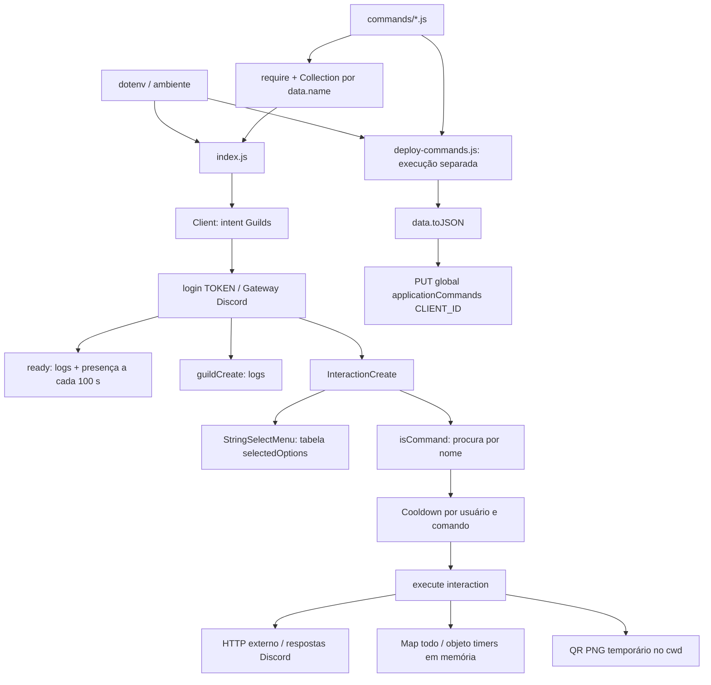

# Arquitetura implementada

Auditoria de 2026-11-07, base `cea09b90889716b5b05139eaf06f8b0e858f179e`. Este mapa descreve o código encontrado; conexão com Discord e APIs externas permanece `NOT_CONFIRMED`. Consulte também [estado](PROJECT_STATE.md), [comandos](COMMANDS.md), [operação](OPERATIONS.md) e [riscos](KNOWN_RISKS.md).

## Componentes e responsabilidades

É um bot JavaScript CommonJS em um único processo Node.js, orientado a eventos do discord.js 14. Não há camadas de domínio, serviços ou repositórios separadas: cada comando concentra definição pública e execução. Não foram encontrados banco de dados, servidor HTTP próprio, fila, testes reais, configuração de CI ou infraestrutura de hospedagem versionada.

| Componente | Responsabilidade efetiva |
|---|---|
| [index.js](../../index.js) | Carrega configuração e módulos, instancia Client, conecta ao Gateway, trata eventos, cooldowns e select menu de documentação. |
| [deploy-commands.js](../../deploy-commands.js) | Processo separado que importa os mesmos comandos e substitui sua definição global na API REST Discord v10. Não é chamado pelo runtime. |
| [commands/](../../commands/) | 23 módulos com `data` (SlashCommandBuilder) e `async execute(interaction)`; comunicação externa e estado local ficam nos próprios módulos. |
| [images/](../../images/) | Três imagens versionadas; `lofiradio.jpeg` e `lofiicon.png` são anexadas pelo comando Lofi. A presença de `topgg.png` não implica seu uso por `/vote`. |
| [package.json](../../package.json), [package-lock.json](../../package-lock.json) | Faixas de dependências e resolução exata. Lockfile v3; entrada principal `index.js`; único script é um `test` placeholder que falha. |
| [.gitignore](../../.gitignore), [.env.example](../../.env.example) | `.env` e `node_modules` ignorados; exemplo público de configuração. Segredos são locais/externos ao Git. |
| [AGENTS.md](../../AGENTS.md), [docs/](../README.md) | Protocolo permanente e memória documental. Descrevem o sistema; não implementam comportamento do bot. |

## Inicialização e ciclo de vida

1. `dotenv.config()` carrega `.env` relativo ao diretório de execução; o runtime lê `TOKEN` ([index.js:5–7](../../index.js#L5)).
2. `fs.readdirSync` encontra somente arquivos `.js` diretamente em `commands/`, usando caminho a partir de `__dirname`. Cada módulo é importado antes do login. A verificação exige apenas as propriedades `data` e `execute`; a Collection usa `command.data.name` como chave ([index.js:12–26](../../index.js#L12)).
3. O Client solicita somente o intent `Guilds` ([index.js:15](../../index.js#L15)). Não há leitura de mensagens, intent privilegiado de membros ou reprodução de áudio implementados.
4. `ready` imprime tag do bot e nomes/IDs/contagens dos servidores em cache. Um intervalo de 100 segundos seleciona uma das 27 presenças estáticas. Os textos de presença, como “monitorando métricas”, não comprovam funcionalidades correspondentes ([index.js:28–161](../../index.js#L28)).
5. `guildCreate` registra entrada em servidor, data/hora local do processo e total em cache. A região `pt-BR` formata o texto, sem fixar fuso horário ([index.js:164–174](../../index.js#L164)).
6. `client.login(TOKEN)` inicia a conexão, sem validação de ambiente ou tratamento explícito de rejeição dessa Promise. A tabela de documentação e o listener de interações são declarados na sequência; `/docs` é novamente registrado na mesma Collection ([index.js:175–211](../../index.js#L175)).
7. Não há handlers próprios de SIGINT/SIGTERM, `client.destroy()` de encerramento, limpeza do intervalo de presença, persistência ou recuperação automática do estado de comandos. Parar o processo perde estado volátil; operação está descrita em [OPERATIONS.md](OPERATIONS.md).

## Interações, cooldown e erros

O listener examina primeiro `isStringSelectMenu()`. Pega `values[0]`, consulta `selectedOptions` e responde com o link ou “Opção não reconhecida”. A tabela contém 26 tecnologias, e o menu de `/docs` é construído separadamente em [commands/docs.js](../../commands/docs.js). Não há validação do `customId` nem cooldown para select menus ([index.js:178–229](../../index.js#L178)).

Para `isCommand()`, procura o nome na Collection; se não encontrar, apenas registra erro e retorna. O cooldown é uma Collection por comando contendo timestamps por ID de usuário. Usa `(command.data.cooldown || 5) * 1000`; nenhum módulo define `data.cooldown`, portanto o padrão atual é cinco segundos. A chave não inclui servidor. Registra o timestamp antes de executar, mesmo quando a execução falha, e o remove por `setTimeout`; reinícios e outros processos não compartilham esse limite ([index.js:230–267](../../index.js#L230)).

Há `try/catch` externo do listener, tratamento local de respostas do select/cooldown e tratamento de erros de `execute`. O erro de execução tenta sempre `interaction.reply`, sem distinguir resposta já enviada ou deferida. Vários módulos também têm seus próprios catches; não há camada comum para timeout, validação de schemas ou resposta de falha. Callbacks posteriores, como o envio no timer, ficam fora do alcance do `await command.execute` ([index.js:266–280](../../index.js#L266), [commands/timer.js:54–57](../../commands/timer.js#L54)).

## Registro e autenticação

[deploy-commands.js:3–25](../../deploy-commands.js#L3) carrega `TOKEN` e `CLIENT_ID`, importa todos os módulos e gera `data.toJSON()` antes do bloco `try`. Cria `REST({ version: "10" }).setToken(TOKEN)` e executa `PUT Routes.applicationCommands(CLIENT_ID)` com o catálogo completo. O alvo é global, sem `GUILD_ID`, e o conjunto remoto é substituído. Não há modo de simulação nem seleção de comando individual.

O registro não inicia o Client e o runtime não registra comandos remotamente. Configuração do aplicativo, scopes, permissões e correspondência de token/aplicação dependem do Discord; seu estado atual é `NOT_CONFIRMED`. O fallback de `/invite` aponta para um ID de aplicação fixo com scopes `bot applications.commands` e `permissions=0`, que não comprova permissões efetivas nos canais.

**Não executar o registro como teste local.** A tarefa documental não autoriza alterações na API do Discord.

## Dependências e integrações

| Dependência | Versão resolvida no lock | Uso observado |
|---|---|---|
| discord.js | 14.18.0 | Gateway, builders, Collections, respostas e registro REST; API REST v10. |
| axios | 1.8.4 | Consultas HTTP em seis comandos. |
| dotenv | 16.4.7 | Configuração em `index.js` e `deploy-commands.js`. |
| qrcode | 1.5.4 | Geração de PNG local. |
| node-fetch | 3.3.2 | Declarado, mas sem importação encontrada; `/github` usa `fetch` global. |
| prettier | 3.5.3 | Formatação de código durante execução; declarado como devDependency apesar de obrigatório no carregamento. |

`/translate` importa `@discordjs/builders` diretamente, embora ele seja apenas dependência transitiva do discord.js. O projeto não declara `engines` ou versão de Node. Os requisitos do lock chegam a Node `>=18.17` por `undici 6.21.1`; esse mínimo de pacote não é uma recomendação de suporte operacional atual. Ambiente e política de versão estão em [OPERATIONS.md](OPERATIONS.md).

| Fronteira externa | Comandos / uso | Autenticação observada |
|---|---|---|
| Gateway e REST Discord | Login, eventos, respostas e registro global | `TOKEN`; `CLIENT_ID` para registro. |
| `api.github.com` | `/github`: dados de repositório via fetch global; `/repositorys`: busca por linguagem via axios | Sem token explícito. |
| `api.stackexchange.com/2.3/search` | `/question`: pesquisa de títulos no Stack Overflow | Sem chave explícita. |
| `translate.googleapis.com/translate_a/single` | `/translate`: tradução com `client=gtx`, origem automática | Sem chave explícita. |
| `api.exchangerate-api.com/v4/latest` | `/moeda`: taxas e cálculo local | Sem chave explícita. |
| `httpstat.us` | `/http`: código/descrição HTTP; 1xx é tratado localmente | Sem chave explícita. |
| URL fornecida pelo usuário | `/status`: GET HTTP(S), timeout de cinco segundos | Sem restrição de destino implementada. |
| Spotify, top.gg, Lofi Radio, autor, documentação, imagens externas | Links, botões e imagens exibidos nas mensagens/presença | Não há integração OAuth/API própria nesses links. |

As APIs HTTP são chamadas antes da primeira resposta, sem `deferReply`; somente `/status` define timeout HTTP explicitamente. Disponibilidade, rate limits, contratos atuais e destinos de links não foram verificados remotamente. As únicas variáveis de ambiente referenciadas no código são `TOKEN`, `CLIENT_ID`, `INVITE_URL` e `LOFIRADIO_URL`.

## Estado e acoplamentos

- `/todo` mantém Map por usuário e `/timer` mantém objeto de handles por usuário: ambos voláteis, compartilhados entre servidores daquele processo, sem backup. Respostas normais são públicas; detalhes e riscos estão no [catálogo](COMMANDS.md) e em [R09](KNOWN_RISKS.md#r09).
- `/qrcode` grava PNG no diretório de execução, anexa e remove o arquivo após reply bem-sucedido. Diferentemente das imagens Lofi, seu caminho não parte de `__dirname`.
- Runtime e registro importam todos os módulos: uma dependência ausente em um comando afeta ambos. Carregamento, respostas e lógica de negócio não estão isolados.
- `/docs` distribui a definição do menu no módulo e a interpretação das opções em `index.js`. `/help` deriva dinamicamente nomes e descrições da Collection de comandos carregados, sem consultar o registro remoto.
- IDs, cores, rodapés, links e mensagens estão repetidos nos comandos. Não há configuração central desses dados.

Oportunidades **propostas, sem refatoração nesta tarefa**: compartilhar validação/carregamento entre runtime e registro, extrair roteamento de componentes, centralizar cliente HTTP e tratamento de respostas, explicitar configuração e decidir persistência/privacidade de estado. A sequência sugerida está em [ROADMAP.md](ROADMAP.md); não representa decisões históricas ou aprovação de implementação.
